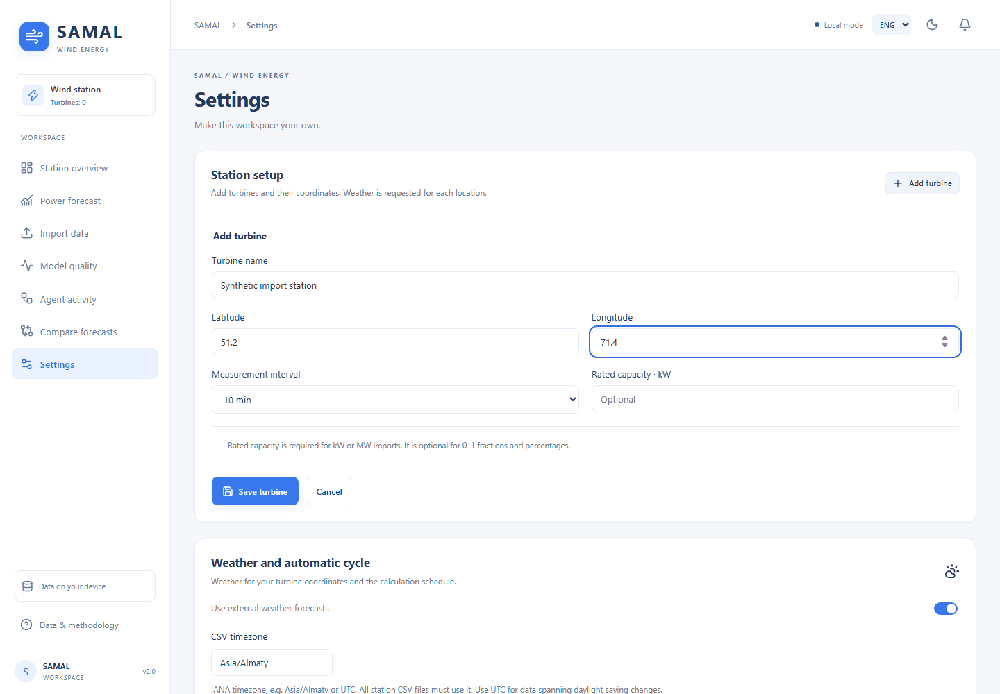
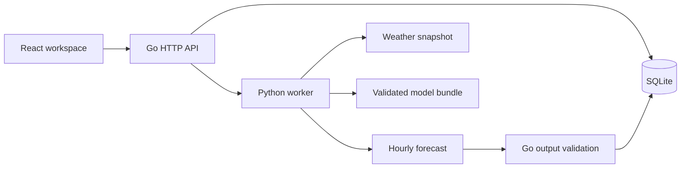

# SAMAL · Wind power forecasting

[](https://github.com/IliasGalikhanov/samal-wind-forecast/actions/workflows/ci.yml)
[](LICENSE)

Русский · [English](README.en.md)

**От истории измерений и координат турбин до почасового прогноза мощности на 24–48 часов.** SAMAL проверяет CSV, получает погоду, обучает и сравнивает модели, сохраняет прогноз и объясняет решения в журнале.

**Go · React · TypeScript · Python · CatBoost · SQLite · Docker**



*Настройка и импорт в обычной установке, затем прогноз и журнал в отдельном синтетическом демо. [Подробности записи](docs/demo.md).*

## Попробовать

Нужен Docker с Compose. Сборка скачивает зависимости; готовое демо работает без внешнего погодного API.

```sh
git clone https://github.com/IliasGalikhanov/samal-wind-forecast.git
cd samal-wind-forecast
docker compose --profile demo up --build -d --wait demo
```

Откройте [localhost:8081](http://localhost:8081). Демо содержит 153 дня вымышленных измерений и погоду, обучает настоящие CatBoost-модели и строит прогноз. Первый расчёт занимает несколько минут; повторный использует совместимые сохранённые модели.

Для своих данных: `docker compose up --build -d --wait app`, затем [localhost:8080](http://localhost:8080). Добавьте турбины и координаты, выберите часовой пояс, импортируйте CSV. [Формат данных и инструкция](docs/user-guide.md).

## Что можно проверить

- **Полный цикл:** собственные турбины → CSV с сопоставлением столбцов → погода → обучение → прогноз → экспорт.
- **Качество данных:** единицы доля/проценты/кВт/МВт, дубликаты, атомарное отклонение конфликтов, сохранение пропусков.
- **Модели:** четыре временные проверки, сравнение с persistence и сезонным профилем, отдельный исторический аудит.
- **Повторные расчёты:** кеш по данным, конфигурации и коду; новая погода обрабатывается без повторного обучения.
- **Устойчивость:** повторы временных ошибок погоды, отмена задачи, отказ от неполного прогноза, сохранение предыдущего результата.
- **Интерфейс:** русский, казахский и английский, светлая/тёмная тема, история, сравнение, резервные копии.

## Устройство



Go обслуживает интерфейс и API, хранит данные и управляет задачами. Python отвечает за признаки, обучение и прогноз. Расчёт запускается отдельным процессом и может быть отменён. Агент следует явной программной политике решений; LLM для работы не требуется.

[Архитектура](docs/architecture.md) · [Решения и компромиссы](docs/decisions.md) · [API и примеры](docs/api.md) · [OpenAPI](docs/openapi.json)

## Модель и доказательства

[Синтетический отчёт](docs/reports/synthetic.md) показывает сравнение моделей, ошибки по горизонту и трудные случаи. Его можно построить из публичного клона:

```sh
python scripts/demo.py --verify --output runtime/portfolio-demo
python scripts/portfolio_report.py
```

Нужны зависимости из `ml/requirements.lock.txt`. Первый скрипт обучает модели, затем запрещает повторное обучение и проверяет кеш. Второй сверяет данные с генератором и восстанавливает исторический аудит.

**Синтетические метрики проверяют конвейер, а не точность на реальной ВЭС.** Результат — нормализованная мощность, а не МВт·ч. Фактические остановки и ограничения сети модель не знает. Отдельный эксперимент на непубличных данных и допущения описаны в [model.md](docs/model.md).

## Проверки и разработка

GitHub Actions проверяет Go, Python, форматирование и сборку React, браузерные сценарии, синтетическое обучение, Docker и сохранность данных после перезапуска. E2E использует отдельные временные базы и вымышленную погоду.

```sh
npm --prefix frontend run format:check
npm --prefix frontend run test:e2e
```

Для E2E нужны Go, Node.js 24, Python 3.12 с ML-зависимостями и Chromium: `cd frontend && npx playwright install chromium`. Полная установка: [руководство](docs/user-guide.md), [воспроизводимость](docs/reproducibility.md), [правила изменений](CONTRIBUTING.md).

## Данные и лицензии

Самостоятельный учебный проект по мотивам задачи HackAlem AI. Исходный датасет не распространяется. Пользовательские CSV, модели, базы, резервные копии и результаты остаются локально; публичные примеры синтетические.

Код — [MIT](LICENSE), зависимости — [THIRD_PARTY_NOTICES](THIRD_PARTY_NOTICES.md). Обычный режим использует Open-Meteo / DWD ICON Global с атрибуцией CC BY 4.0 и [условиями API](https://open-meteo.com/en/terms). Приложение рассчитано на локальную работу одним пользователем.
