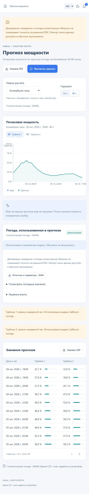
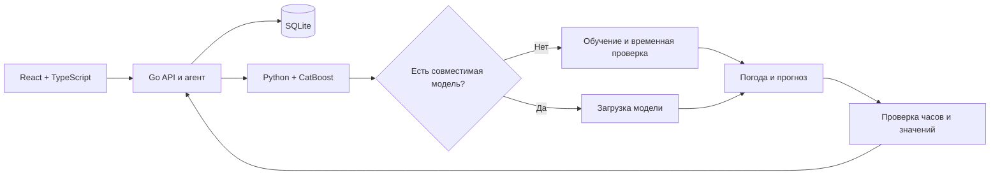

# SAMAL

[](https://github.com/IliasGalikhanov/samal-wind-forecast/actions/workflows/ci.yml)
[](LICENSE)

Почасовой прогноз нормализованной мощности ветровых турбин на 24–48 часов. Пользователь добавляет свои турбины, координаты и историю измерений; приложение получает погоду для этих точек и обучает модели. Стек: **Go · React · TypeScript · Python · CatBoost · SQLite · Docker**.

Самостоятельный портфолио-проект по мотивам задачи HackAlem AI, разработанный после хакатона с использованием **OpenAI Codex** для написания кода, тестов и документации. Это не заявка на соревнование; участие, победа и одобрение организаторов не заявляются. Сторонние библиотеки перечислены в [THIRD_PARTY_NOTICES.md](THIRD_PARTY_NOTICES.md).

**Исходный датасет не распространяется.** В GitHub публикуются код, документация, синтетический пример и генератор. Реальные измерения, обученные на них модели, SQLite, резервные копии и результаты остаются локально. Метрики реального эксперимента в [описании модели](docs/model.md) получены на непубличных исходных данных; воспроизвести именно эти числа из публичного клона нельзя.



## Попробовать без исходных данных

Нужен Docker Desktop с Linux containers или Docker Engine с Compose.

```sh
git clone https://github.com/IliasGalikhanov/samal-wind-forecast.git
cd samal-wind-forecast
docker compose --profile demo up --build -d --wait demo
```

Откройте [localhost:8081](http://localhost:8081), затем нажмите «Рассчитать прогноз». Обе истории уже загружены. При первом запуске агент также автоматически начнёт расчёт в течение минуты, если вы его ещё не запустили.

- Генератор создаёт 153 дня 10-минутных измерений двух вымышленных турбин и синтетическую погоду.
- Выполняются обучение CatBoost, четыре временные проверки, отдельная оценка и прогноз на 48 часов.
- Повторный расчёт использует сохранённые модели. Журнал и карточка погоды показывают, было ли обучение.
- В интерфейсе и JSON есть отметка о синтетике; CSV прогноза содержит `data_source=synthetic`. Демометрики показывают работу конвейера, **не точность на настоящей ВЭС**.
- У демо отдельный том `samal-demo-data`; импорт своих файлов и восстановление чужой базы здесь отключены. Обычное приложение запускается отдельно.

Сборка образа требует интернета для зависимостей. После сборки демо работает без погодного API и исходного датасета.

Полный пример без интерфейса, с фиксированными датами и проверкой повторного использования модели:

```sh
docker compose run --rm --no-deps --entrypoint /opt/venv/bin/python demo /app/scripts/demo.py --verify
```

Или после установки Python-зависимостей: `python scripts/demo.py --verify`. Второй расчёт программно запрещает обучение и проверяет, что получен новый прогноз с сохранённой моделью. JSON, CSV, модели и отчёт времени сохраняются в `runtime/demo-cli/` (в контейнере — внутри демотома).

## Работа со своими измерениями

```sh
docker compose up --build -d --wait app
```

Откройте [localhost:8080](http://localhost:8080). При занятых портах скопируйте `.env.example` в `.env` и измените `SAMAL_PORT` / `SAMAL_DEMO_PORT`.

1. В «Настройках» задайте часовой пояс IANA (например, `Asia/Almaty` или `UTC`) и сохраните. Все файлы одной установки используют общий пояс. Для истории с переходами на летнее время предварительно приведите отметки к UTC.
2. Добавьте турбины: название, широта, долгота, интервал измерений 5/10/15/20/30/60 минут. Количество не привязано к двум исходным турбинам. Для импорта кВт/МВт укажите номинальную мощность в кВт.
3. На странице «Импорт данных» выберите турбину и CSV, разделитель, столбцы и единицы мощности. Проверьте предварительный просмотр. До загрузки всех историй отключите «Рассчитать после импорта» и автоматическое обновление погоды.
4. Откройте «Прогноз мощности», режим «Ближайшие часы», горизонт 24 или 48 часов. Нажмите «Рассчитать прогноз». Первый расчёт получает архив погоды и обучает модели; нужен интернет и несколько минут. Далее новая погода обрабатывается сохранённой моделью.
5. Изучите прогноз, погодные входы, качество и решения агента; скачайте CSV. При необходимости включите автоматическое обновление раз в 6 часов.

Новая обычная установка начинается без турбин. Существующая база сохраняет свои турбины и измерения. После импорта часовой пояс, интервал и номинальная мощность зафиксированы, чтобы загруженные значения не меняли смысл; название и координаты можно исправить. Изменение координат вызывает обучение новой модели при следующем расчёте. Резервная копия включает каталог турбин и настройки.

Пользовательские данные находятся в томе `samal-data`. `docker compose down` сохраняет тома; добавление `--volumes` удаляет их данные. Исходные CSV, модели и локальная база в образ не включаются.

### Формат CSV

Отдельный файл для каждой турбины, которая выбирается при импорте. Кодировка **UTF-8** (BOM допустим). Разделитель: запятая, точка с запятой или табуляция. Дробная часть: точка либо запятая (при разделителе-запятой такие числа должны быть заключены в кавычки).

Нужны четыре столбца: время, ветер, мощность, температура. Названия и порядок могут быть своими — сопоставьте их в интерфейсе. Дополнительные столбцы сохраняются в исходном файле, но не используются моделью. Заголовки должны быть уникальными. Исходные русские заголовки и английские `time,wind,power,temperature` распознаются автоматически. Совместимый пример:

```csv
ID,Статистическое время,Средняя скорость ветра(m/s),Нормализованная активная мощность,Средняя температура окружающей среды(°C)
1,2026-01-01 00:00:00,6,0.2,3
2,2026-01-01 00:10:00,6.2,0.21,3
```

Пример вымышленный. Готовый [маленький CSV](data/demo/turbine.csv) подходит для проверки импорта; двух часов недостаточно для обучения. Для полного демо используйте генератор выше.

| Поле | Значение и ограничения |
|---|---|
| `ID` | Необязательный идентификатор строки; в модели не используется |
| `Статистическое время` | `YYYY-MM-DD HH:MM:SS`, начало интервала в настроенном часовом поясе; минуты кратны интервалу турбины, секунды 00 |
| `Средняя скорость ветра(m/s)` | Число от 0 до 100, м/с |
| `Нормализованная активная мощность` | Выберите единицы: доля 0–1, проценты 0–100, кВт или МВт. Для кВт/МВт значение делится на номинальную мощность; результат должен быть в диапазоне 0–1 |
| `Средняя температура окружающей среды(°C)` | Число от −100 до 100, °C |

Пустые, NaN и бесконечные значения не принимаются. Совпадающие дубликаты пропускаются, разные значения для одного времени отклоняются. Полный час содержит `60 / интервал` измерений; пропуски не заменяются нулями. Для погодного обучения ориентируйтесь как минимум на 100 полных дней общей истории всех загруженных турбин после января 2024; возможность обучения зависит от полноты измерений и погоды.

Результат — средняя нормализованная мощность каждого часа, в интерфейсе 0–100%. Экспорт прогноза также нормализован. Для импортированных долей/процентов пользователь должен знать их смысл; приложение не определяет формулу нормировки по значениям автоматически.

По координатам приложение получает прогноз скорости и направления ветра на 100 м и температуры на 2 м из Open-Meteo (DWD ICON Global). Для обучения запрашивается архив прогнозов. Состояние оборудования, остановки, ремонты и ограничения сети из координат получить нельзя; отдельного учёта этих пользовательских данных в текущей модели нет. Высота погодного ветра фиксирована, она не заявляется фактической высотой ротора.

## Возможности и архитектура

- Настраиваемый каталог турбин, координаты, часовой пояс, интервалы измерений и номинальные мощности.
- Импорт с выбором столбцов и единиц, предпросмотром, проверкой значений и дубликатов; история, сравнение и экспорт прогнозов.
- Текущая погода Open-Meteo по координатам турбин; архивная погода для обучения.
- Выбор модели по MAE и RMSE; резерв без свежих измерений; отказ от публикации неполного результата.
- Авторасчёт после импорта и обновление прогноза раз в 6 часов, пока работает приложение.
- Журнал решений, отмена, повторы временных ошибок API, резервная копия и восстановление.
- Русский, казахский и английский; светлая, тёмная и системная темы.



Агент реализован как программная политика решений; LLM не используется. Go управляет импортом, расписанием и процессом Python. Python обучает, выбирает и применяет модели. Подробности: [архитектура](docs/architecture.md), [агент](docs/agent.md), [модель](docs/model.md).

Модель переиспользуется по SHA-256 измерений, горизонту, координатам, часовому поясу, источнику данных, коду, признакам, параметрам и версиям ML-зависимостей. Новая погода или начало прогноза не требуют обучения. Новые измерения либо смена конфигурации создают новую модель. Повреждённый кеш пересоздаётся; исходные файлы не удаляются.

## Расчёт командой

После импорта в обычное приложение:

```sh
python scripts/forecast.py --mode live --horizon 48
python scripts/forecast.py --mode live --horizon 48 --force-retrain
```

CLI использует тот же API, что интерфейс, и сохраняет JSON/CSV в `exports/<run-id>/`. Для Docker CLI: создайте каталог `exports`, затем `docker compose run --rm forecast`. На Linux задайте `SAMAL_UID` и `SAMAL_GID` в `.env`, если ваш пользователь отличается от 1000.

Исторический режим: `--mode dataset --origin YYYY-MM-DDTHH:00 --days 1`. Начало должно быть после последнего импортированного измерения; доступно до 31 ежедневного момента расчёта. Основной сценарий — ближайшие 24–48 часов.

## Разработка и проверки

Нужны Go 1.25+, Node.js 24 и Python 3.12. Windows PowerShell:

```powershell
./setup.ps1 -PythonPath C:/path/to/python.exe
./start.ps1
# В другом терминале:
./check.ps1
.venv/Scripts/python.exe scripts/demo.py --verify
```

Linux/macOS:

```sh
python3.12 -m venv .venv
.venv/bin/python -m pip install -r ml/requirements.lock.txt
npm --prefix frontend ci
npm --prefix frontend run build
go run ./cmd/server
```

Для React hot reload: `npm --prefix frontend run dev`. Go в обычном запуске раздаёт `frontend/dist`. На Windows `start.ps1` может импортировать локальные `data/raw/turbine 1.csv` и `turbine 2.csv`, если вы сами их положили туда; в публичном клоне их нет.

GitHub Actions проверяет состав и историю Git-файлов, распространённые форматы секретов, Go format/vet/tests, Python tests, полное синтетическое обучение и повторное применение модели, TypeScript/build, Docker и сохранность данных после перезапуска. Актуальный результат — в [Actions](https://github.com/IliasGalikhanov/samal-wind-forecast/actions). [Сценарии и локальные результаты](docs/reproducibility.md). Правила изменений и коммитов — в [CONTRIBUTING.md](CONTRIBUTING.md).

## Публикация и лицензии

Корень репозитория содержит `go.mod`, `frontend/` и `.github/`. `.gitignore` исключает `data/raw/`, `runtime/`, модели, базы, архивы, `.env`, ключи, кеши и экспорты. Перед коммитом после `git add` выполните `python scripts/check_publication.py --history`: проверка анализирует Git index и всю локальную историю, включая содержимое файлов на распространённые форматы секретов. Она сообщает пути и тип проблемы, не выводя найденные ключи. Просмотрите staged diff: автоматическая проверка не обнаруживает все возможные секреты. Не используйте `git add -f` для приватных файлов.

Собственный код и синтетический генератор — [MIT](LICENSE). Сторонние компоненты — [уведомления и лицензии](THIRD_PARTY_NOTICES.md). Погода обычного режима: [Open-Meteo](https://open-meteo.com/en/docs), DWD ICON Global; сохраняется атрибуция CC BY 4.0 и действуют [условия API](https://open-meteo.com/en/terms).
