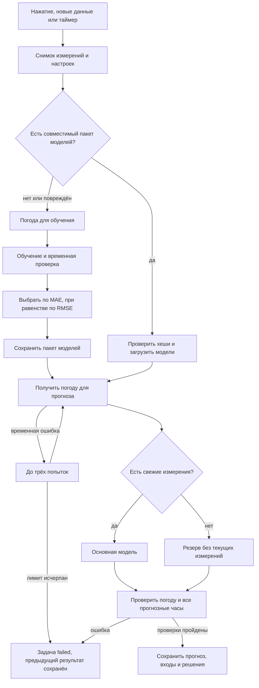

# Как агент принимает решения

SAMAL — автономный цикл прогнозирования с программной политикой. ML отвечает за численные прогнозы. Оркестрация, правила выбора и проверки реализованы в Go и Python; LLM не используется.

| Условие | Действие | Доказательство |
|---|---|---|
| Новый уникальный импорт и включён auto_run | Запуск с обновлённой историей | ID импорта и задачи |
| Измерения и конфигурация совпадают с сохранённым пакетом | Загрузить модель без обучения | WEATHER_MODEL_REUSED, training.reused=true |
| Изменились данные/настройки/код, пакета нет, он повреждён или запрошен force_retrain | Повторить обучение и выбор | Новый bundle_id либо новая версия пакета, WEATHER_MODEL_TRAINING |
| Включён live и auto_refresh | Проверка раз в минуту; успешные прогнозы обновляются не чаще раза в 6 часов | Триггер weather_update |
| API вернул 429/5xx или сетевую ошибку | До 3 запросов, паузы 5 и 10 секунд | WEATHER_RETRY в журнале |
| API вернул постоянную ошибку | Завершение failed | Ошибка в задаче |
| Есть несколько методов | Сравнение на четырёх временных отрезках | Метрики и WEATHER_SELECTED |
| Свежие лаги отсутствуют | Резерв между погодным CatBoost и сезонным профилем | decisions и WEATHER_ROUTE |
| Неполная погода, неверные часы или значения | Отказ от публикации | Ошибка; старый прогноз остаётся доступным |
| Проверки пройдены | Публикация completed | Событие сохранения, CSV, JSON |

Основная модель выбирается по общей MAE на одинаковых доступных часах; RMSE разрешает равенство. Отдельный исторический тест не используется для смены победителя. Для резервного метода применяются те же правила, но только среди методов без свежих SCADA-измерений.

В результате есть `decisions`: момент, турбина, выбранная модель, причина `fresh_measurements` или `stale_measurements` и политика выбора. Интерфейс переводит причины на русский, казахский и английский. Повторы API видны в журнале даже для неудачных запусков.

## Демонстрация

1. Запустить `docker compose --profile demo up --build -d --wait demo`, открыть localhost:8081 и нажать расчёт. Измерения и погода в этом режиме синтетические.
2. В журнале показать получение погоды, временную валидацию, выбор и сохранение.
3. Открыть «Решения агента»: для старой истории используется резерв без свежих измерений.
4. Открыть «Качество модели»: показать значения, на основании которых сделан выбор.
5. Запустить `pytest`: сетевые отказы и некорректные результаты воспроизводятся с подменённым транспортом.
6. Повторить расчёт: журнал покажет загрузку сохранённой модели. `python scripts/demo.py --verify` проверяет этот сценарий, запрещая вызов обучения при втором прогнозе.

Проверки находятся в `ml/test_weather.py`, `internal/app/validation_test.go` и тестах импорта. Этот набор показывает наблюдаемые решения системы; проект не заявляет свободное планирование LLM.
