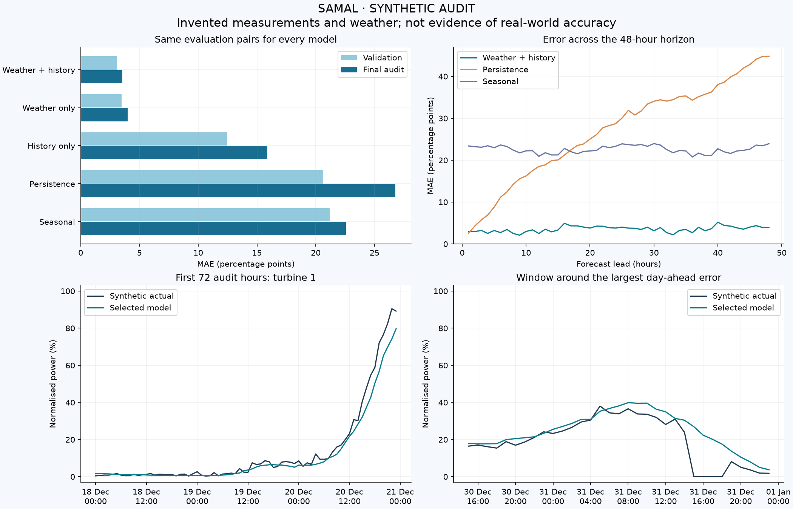

# Synthetic model audit / Синтетический аудит модели

**All measurements and weather in this report are invented. / Все измерения и погода вымышлены.**



## Reproduce / Воспроизведение

```sh
python scripts/demo.py --verify --output runtime/portfolio-demo
python scripts/portfolio_report.py
```

The report checks the input hash and compares every input row with the public generator before writing files. It reconstructs the final audit using models trained before the audit period; the final inference models are not used.

Selected on four temporal validation folds: **Weather + history**. Final audit: 2025-12-18 00:00:00 to 2026-01-01 00:00:00 (exclusive).

| Model | Validation MAE, pp | Audit MAE, pp | Audit RMSE, pp | Pairs |
|---|---:|---:|---:|---:|
| Weather + history | 3.057 | 3.551 | 5.519 | 1296 |
| Weather only | 3.488 | 3.998 | 6.075 | 1296 |
| History only | 12.442 | 15.879 | 24.360 | 1296 |
| Persistence | 20.633 | 26.773 | 39.020 | 1296 |
| Seasonal | 21.199 | 22.565 | 30.679 | 1296 |

## Largest day-ahead errors / Наибольшие ошибки первых 24 часов

| Time (Asia/Almaty) | Turbine | Actual, % | Forecast, % | Absolute error, pp |
|---|---:|---:|---:|---:|
| 2025-12-31 15:00:00 | 2 | 0.00 | 26.93 | 26.93 |
| 2025-12-26 15:00:00 | 1 | 86.67 | 63.13 | 23.54 |
| 2025-12-31 16:00:00 | 2 | 0.00 | 22.34 | 22.34 |
| 2025-12-26 19:00:00 | 1 | 89.48 | 68.83 | 20.65 |
| 2025-12-31 17:00:00 | 2 | 0.00 | 20.14 | 20.14 |

## Interpretation / Интерпретация

The synthetic power curve has a known relationship with wind. The generator also adds forecast error, measurement noise and invented outages. The two lower plots expose failures hidden by the average MAE; they do not prove the cause of any individual error.

Сравнение использует одинаковые пары прогноз/факт для всех методов. Модель выбирается по четырём предыдущим временным отрезкам, а последний отрезок используется для аудита. График по горизонту усредняет ошибки отдельно для каждого шага; соседние прогнозы перекрываются, поэтому пары не являются независимыми наблюдениями.

This is a deliberately learnable toy system. Low error here confirms pipeline behaviour, not accuracy at a real wind farm. No future operational accuracy, economic savings or uncertainty calibration is claimed. Real-data experiment metrics and their limitations are documented separately in [model.md](https://github.com/IliasGalikhanov/samal-wind-forecast/blob/main/docs/model.md).

Exact metrics can vary slightly across platforms. The input generator and dependency versions are fixed; the audit is recomputed, not copied from a screenshot.
